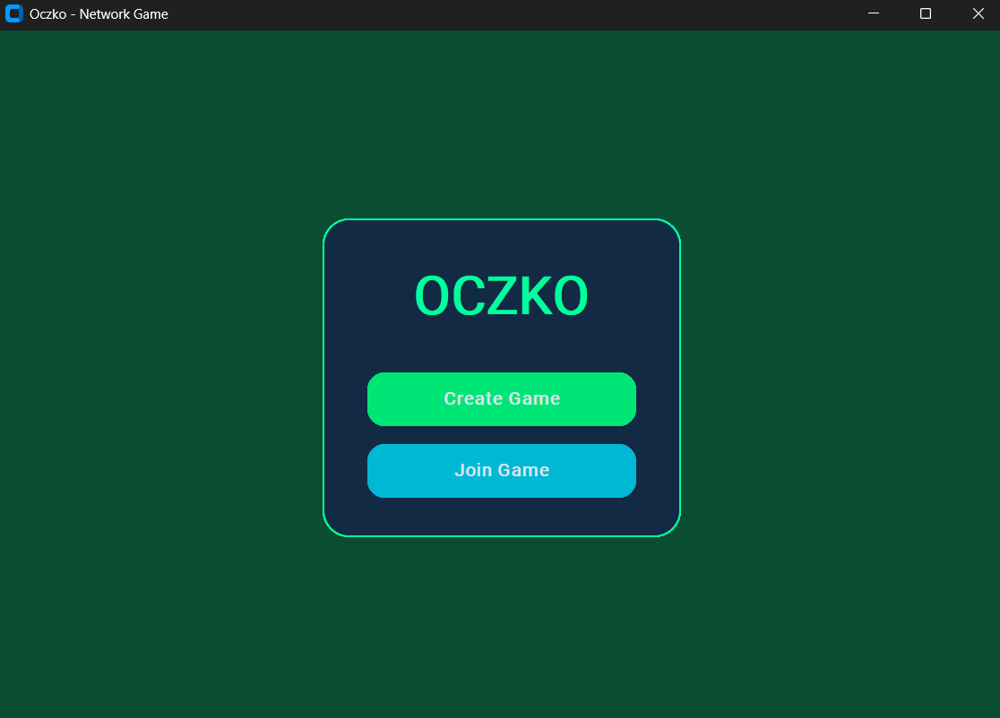
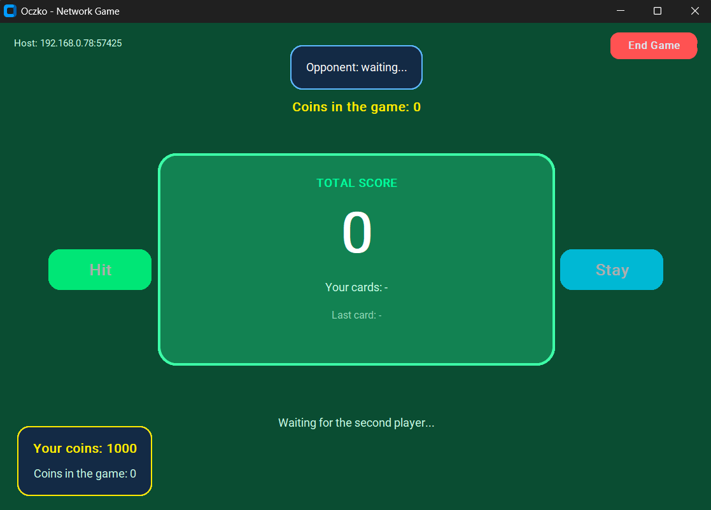
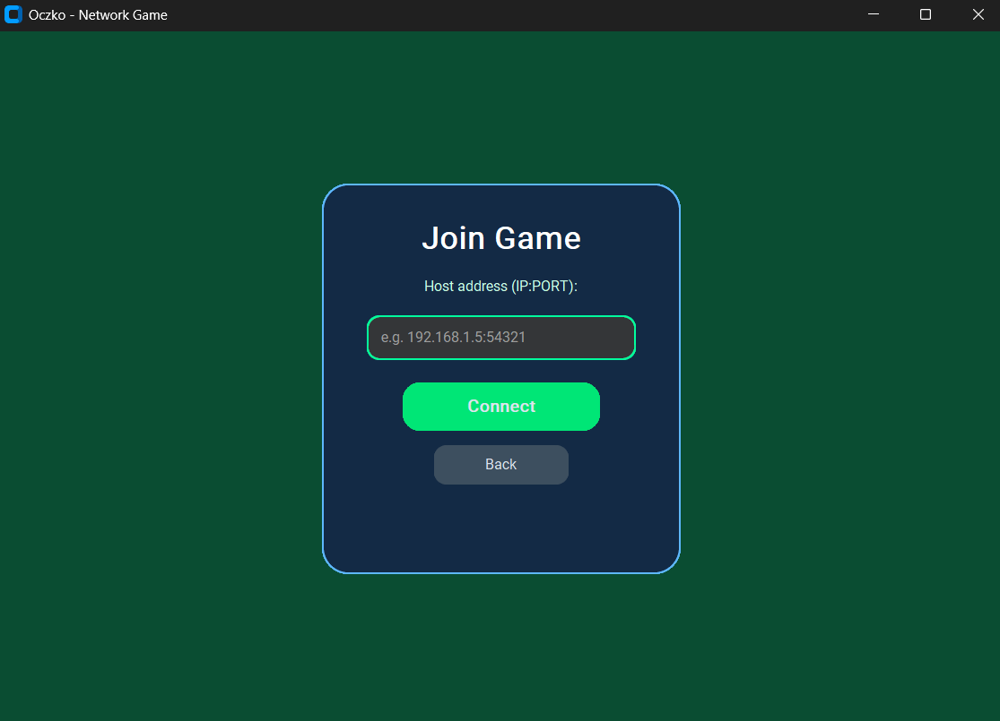
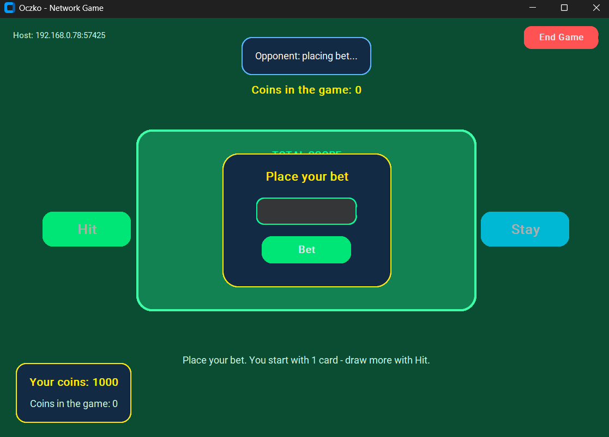
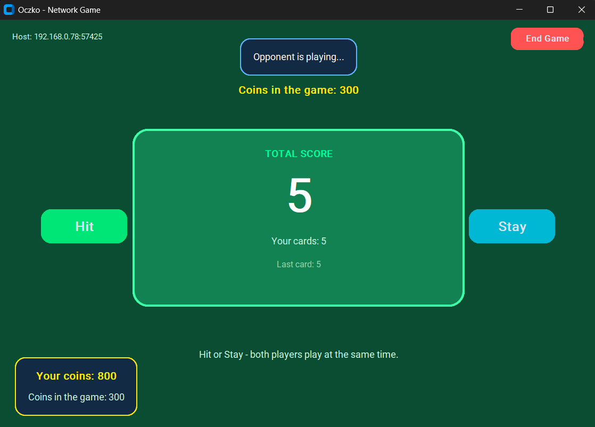
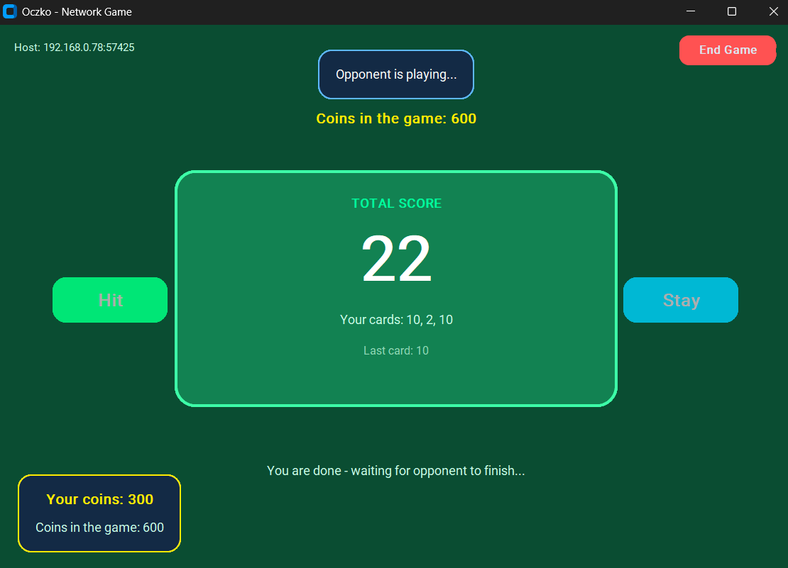
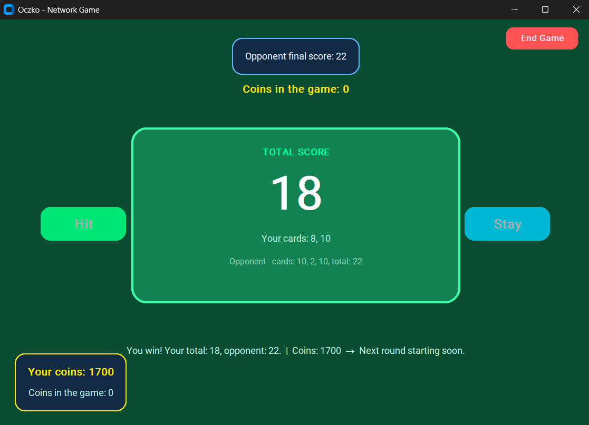

# 🃏 Gra Oczko (Sieciowa) / Network Oczko Game

[](https://www.python.org)  
[](https://github.com/TomSchimansky/CustomTkinter)

## 🇵🇱 O projekcie

Gra wieloosobowa typu "Oczko" (zbliżona do Blackjacka) działająca w sieci LAN. Projekt zaliczeniowy z przedmiotu **Aplikacje Sieciowe** (Politechnika Świętokrzyska). 

Aplikacja realizuje model klient-serwer z wykorzystaniem architektury **Listen-Server**, w której host gry pełni jednocześnie rolę serwera autorytatywnego i gracza.

**Autorzy:** Marcin Hajduk, Kacper Gawęda

### 🛠️ Technologie i architektura

*   **Język i GUI:** Python, CustomTkinter (asynchroniczny interfejs oparty na kolejkowaniu zdarzeń `queue.Queue`).
*   **Sieciowość:** Niskopoziomowe gniazda (`socket`), niezawodny protokół warstwy transportowej **TCP**.
*   **Protokół komunikacyjny:** Własny mechanizm ramkowania wiadomości (Application Layer Protocol) oparty na formacie **JSON** i znakach nowej linii (`\n`), zapobiegający zjawisku TCP Sticky Packets.
*   **Współbieżność:** Wielowątkowość (moduł `threading`), zarządzanie wyścigami danych za pomocą blokad `RLock`. Dedykowane wątki-demony dla interfejsu, serwera i nasłuchiwania klientów.

### ⚙️ Najważniejsze funkcje i rozwiązania techniczne

*   **Architektura Listen-Server:** Brak faworyzowania hosta (Host Advantage). Lokalny klient hosta łączy się z własnym serwerem przez pętlę zwrotną (loopback `127.0.0.1`), a serwer weryfikuje jego ruchy tak samo rygorystycznie, jak gracza z zewnątrz.
*   **Dynamiczna alokacja portów (Porty efemeryczne):** Serwer deleguje przydział portu do systemu operacyjnego, przypisując w gnieździe port `0`. Eliminuje to krytyczne błędy `Address already in use`.
*   **Graceful Disconnect:** Przechwytywanie sygnałów zamknięcia okna i bezpieczne, kontrolowane zamykanie gniazd sieciowych bez pozostawiania osieroconych procesów.
*   **Walidacja danych sieciowych:** Sprawdzanie poprawności wpisywanego adresu IP (przy użyciu `socket.inet_aton`) oraz rozdzielanie ciągów znaków (IP:PORT) po stronie klienta przed próbą połączenia.

### 🎮 Przebieg gry i mechanika

1.  **Ekonomia:** Każdy gracz otrzymuje na start wirtualny portfel z 1000 monet. Wartości są chronione po stronie serwera.
2.  **Faza zakładów (Betting):** Gracze wprowadzają i zatwierdzają stawkę. System nie pozwala na zakłady ujemne lub przewyższające stan konta.
3.  **Faza gry (Playing):** Gracze równolegle i asynchronicznie decydują o dobraniu karty (**Hit**) lub zatrzymaniu (**Stay**). Przekroczenie 21 punktów skutkuje blokadą dobierania (Bust).
4.  **Faza rozstrzygnięcia (Round End):** Serwer weryfikuje punkty, wyłania zwycięzcę, przydziela monety z puli i automatycznie uruchamia timer kolejnej rundy.

---

## 🇬🇧 English Version

### About the Project

A multiplayer "Oczko" (similar to Blackjack) card game operating over a LAN network. A university project for the **Network Applications** course (Kielce University of Technology).

The application implements a client-server model using a **Listen-Server** architecture, where the game host acts simultaneously as an authoritative server and a player.

**Authors:** Marcin Hajduk, Kacper Gawęda

### 🛠️ Technologies and Architecture

*   **Language & GUI:** Python, CustomTkinter (asynchronous UI based on `queue.Queue` event polling).
*   **Networking:** Low-level sockets, reliable **TCP** transport layer protocol.
*   **Communication Protocol:** Custom message framing mechanism based on **JSON** and newline characters (`\n`), preventing the TCP Sticky Packets phenomenon.
*   **Concurrency:** Multithreading (`threading` module), race condition management via `RLock`. Dedicated daemon-threads for UI, server, and client listening.

### ⚙️ Key Features and Technical Solutions

*   **Listen-Server Architecture:** Zero Host Advantage. The host's local client connects to its own server via loopback (`127.0.0.1`), and the server verifies its moves just as strictly as the external player's.
*   **Dynamic Port Allocation (Ephemeral Ports):** The server delegates port assignment to the operating system by binding to port `0`, eliminating `Address already in use` conflicts.
*   **Graceful Disconnect:** Intercepting window close signals for safe, controlled closure of network sockets without leaving zombie processes.
*   **Network Data Validation:** Strict verification of the entered IP address (using `socket.inet_aton`) and robust string splitting (IP:PORT) before attempting a connection.

### 🎮 Game Flow and Mechanics

1.  **Economy:** Each player starts with a virtual wallet of 1000 coins. Values are strictly protected server-side.
2.  **Betting Phase:** Players independently place their bets. The system validates balances to prevent negative or over-budget bets.
3.  **Playing Phase:** Players decide asynchronously to draw a card (**Hit**) or keep their hand (**Stay**). Exceeding 21 points automatically locks drawing actions (Bust).
4.  **Round End Phase:** The server verifies points, determines the winner, distributes the coin pot, and automatically initiates a timer for the next round.

---

## 🚀 Uruchomienie lokalne / Local Setup

### 1. Klonowanie repozytorium / Clone repository (opcjonalnie)
```bash
git clone <adres-twojego-repozytorium>
cd "Gra Oczko"
```

### 2. Środowisko wirtualne / Virtual Environment
```bash
python -m venv .venv

# Windows
.venv\Scripts\activate

# Linux / macOS
source .venv/bin/activate
```

### 3. Instalacja zależności / Install Dependencies
```bash
pip install -r requirements.txt
```

### 4. Uruchomienie ze źródeł / Run from source
```bash
python main.py
```

### 📦 Kompilacja do pliku wykonywalnego / Build .exe (PyInstaller)
```bash
pip install pyinstaller
python -m PyInstaller --noconfirm GraOczko.spec
```
Gotowa gra znajduje się w folderze `dist/GraOczko/`. Należy uruchamiać plik `GraOczko.exe` z tego katalogu.
*(The compiled game is located in the `dist/GraOczko/` folder. Run the `GraOczko.exe` file from this directory.)*

> **Wysyłka innej osobie / Sharing the game:** Spakuj cały folder `GraOczko` do archiwum ZIP (nie wysyłaj samego pliku .exe – obok znajdują się biblioteki niezbędne do działania CustomTkinter).
> *(Pack the entire `GraOczko` folder into a ZIP archive. Do not send just the .exe file – it requires the adjacent libraries to run CustomTkinter properly.)*

---

## 📸 Zrzuty ekranu / Screenshots

*Ekran startowy / Start Screen*  


*Tworzenie gry i wylosowany port hosta / Create Game & Host Port*  


*Dołączanie do gry jako klient / Join Game*  


*Faza obstawiania monet / Betting Phase*  


*Rozgrywka w trakcie rundy / Gameplay*  


*Oczekiwanie na ruch przeciwnika / Waiting for opponent*  


*Koniec rundy i podsumowanie wyniku / Round End Summary*  
